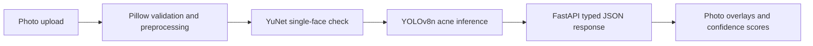

# Glowli — Acne Detection Prototype

Glowli is an experimental computer-vision application that accepts a selfie, checks that it contains exactly one face, and displays predicted acne regions with bounding boxes and confidence scores.

The prototype uses a React interface, a FastAPI backend, YuNet face detection, and a YOLOv8n model fine-tuned for acne detection. Predictions come from the trained model; they are no longer mock responses.

**Status:** the core upload-to-prediction workflow is implemented. Model performance remains limited, and the project is not a diagnostic tool.

## Features

- JPEG, PNG, and WebP uploads with file-size and image-dimension checks.
- Pillow preprocessing for orientation correction, RGB conversion, and metadata removal from the processed image.
- YuNet validation requiring exactly one detected face.
- CPU inference using a fine-tuned YOLOv8n model.
- Typed API responses containing normalized bounding boxes and confidence scores.
- Numbered box overlays that scale with the displayed photo.
- Loading, invalid-upload, model-unavailable, and empty-result states.

The application does not provide skin-type classification, severity grading, product recommendations, or skincare routines.

## Architecture



The backend caches its models and protects shared inference with locks. CPU inference runs in a thread pool so it does not run directly on the async request loop.

Boxes use normalized corner coordinates: `x1`, `y1`, `x2`, and `y2`, relative to the orientation-corrected image. The frontend converts these to percentages and hides overlays if the displayed image dimensions do not match the response.

## Technology

| Area | Tools |
|---|---|
| Interface | React, TypeScript, Vite, CSS |
| API client | Axios |
| Backend | FastAPI, Pydantic |
| Image processing | Pillow, OpenCV |
| Face detection | YuNet |
| Acne detection | Ultralytics YOLOv8n, PyTorch |
| Tests | pytest, Vitest, React Testing Library |

## Dataset and Preparation

The acne subset was prepared from **Skin-Problem-Detection-Relabel-Clean3, version 2**, published on Roboflow by Parin Kittipongdaja.

Preparation included:

- Converting polygon annotations into YOLO bounding boxes.
- Excluding exact-duplicate groups pending label review.
- Auditing visually similar images and grouping flagged matches before splitting to reduce leakage.
- Preserving those split assignments when selecting acne-labeled images.
- Exporting only class `0` (`Acne`) annotations while retaining source attribution files.

| Split | Images | Acne annotations |
|---|---:|---:|
| Training | 809 | 6,666 |
| Validation | 173 | 1,530 |

This subset contains images with acne annotations, **not verified acne-free negatives**. Missing annotations do not establish that an image or region is acne-free. Similarity grouping also does not guarantee that every related image or repeated subject was identified.

Dataset images and trained checkpoints are excluded from Git. Preserve source attribution and review the source dataset's terms before redistribution.

## Training and Evaluation

Fine-tuned YOLOv8n for 10 epochs on an acne detection dataset and evaluated it on a separate validation split. The model remains experimental, with missed detections and false positives. Further evaluation and improvement are ongoing.

The baseline used pretrained YOLOv8n weights, 640-pixel inputs, batch size 4, and CPU execution. Training took approximately 48 minutes. Detailed metrics are retained in the local experiment outputs under `.cache/training/acne_baseline_10/`.

The held-out test split has not been evaluated. Results on the positive-only validation subset do not establish performance on acne-free selfies. Confidence scores are model outputs, not calibrated probabilities of a diagnosis.

## Project Structure

- `web/` — current local demonstration interface.
- `backend/app/` — upload validation, face detection, acne inference, and API.
- `backend/tests/` — API behavior tests.
- `ml/` — annotation conversion, similarity auditing, grouped splitting, export, and training utilities.
- `mobile/` — legacy Expo prototype.
- `.cache/` — ignored local datasets, checkpoints, and experiment outputs.

## Local Setup

Commands below use **Git Bash on Windows**, from the repository root.

### Prerequisites

Install Node.js/npm and Python. The recorded training environment used Python 3.14.6 and CPU PyTorch 2.12.1.

Create the backend environment and install dependencies:

```bash
python -m venv backend/.venv
backend/.venv/Scripts/python.exe -m pip install -r backend/requirements.txt
```

The API expects these local models:

- `backend/models/face_detection_yunet_2023mar.onnx`
- `.cache/training/acne_baseline_10/weights/best.pt`

The acne checkpoint is **not included in Git**, so a fresh clone is not ready for inference until that artifact is available.

To train the current baseline, first prepare the acne export at `.cache/datasets/acne-only-v1/data.yaml` and provide pretrained weights at `.cache/models/yolov8n.pt`, then run:

```bash
backend/.venv/Scripts/python.exe ml/train_acne_model.py
```

Dataset preparation currently uses the utilities in `ml/`; it is not yet packaged as a complete one-command setup.

### Start the API

```bash
cd backend
.venv/Scripts/python.exe -m uvicorn app.main:app --reload --host 127.0.0.1 --port 8000
```

Health check: `http://127.0.0.1:8000/health`

Interactive API documentation: `http://127.0.0.1:8000/docs`

### Start the Interface

In a second terminal, from the repository root:

```bash
cd web
npm ci
npm run dev
```

Open `http://localhost:5173`.

The default API URL is `http://127.0.0.1:8000`. Copy `web/.env.example` to `web/.env.local` to override it.

## Verification

Backend, from `backend/`:

```bash
.venv/Scripts/python.exe -m pytest tests -q
```

Frontend, from `web/`:

```bash
npm test
npm run build
```

Latest verified checks: **14 backend tests passed, 5 frontend tests passed, and the production frontend build passed**. A real validation-image upload also completed through the API and displayed a numbered prediction box.

These checks verify software behavior; they do not establish model accuracy.

## Remaining Work

- Review representative photos and failure cases through the complete application.
- Update remaining interface wording to match the acne-only scope.
- Review annotation quality and add verified negative examples.
- Evaluate confidence thresholds using validation data.
- Improve model performance and document a reproducible artifact setup.
- Evaluate the held-out test set after model-selection decisions are complete.
